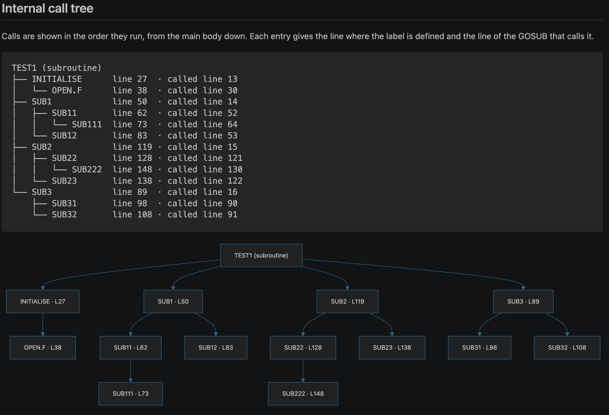
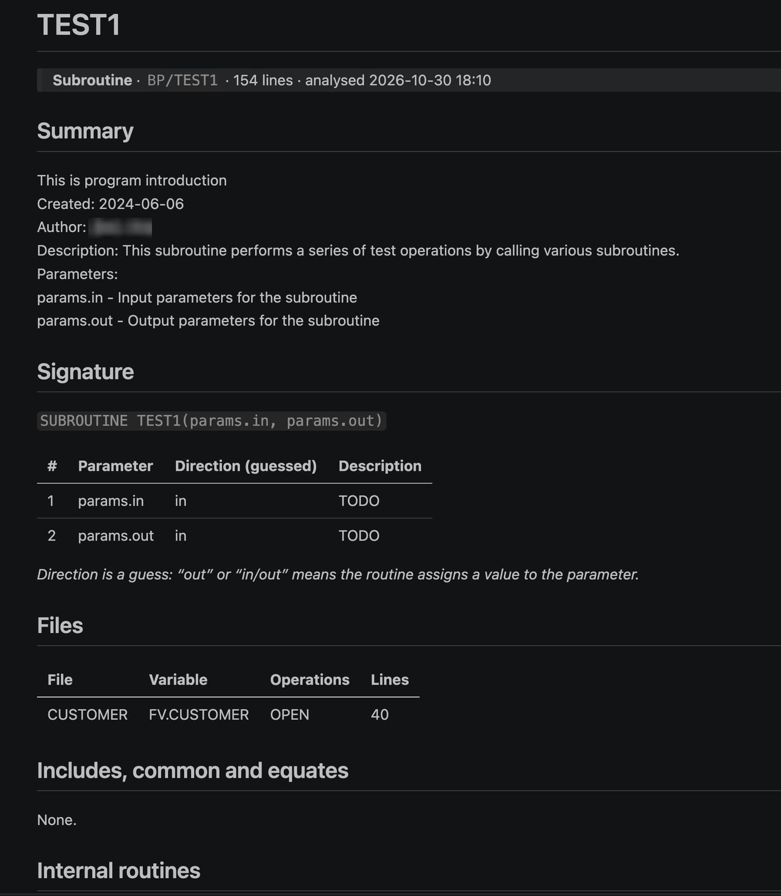
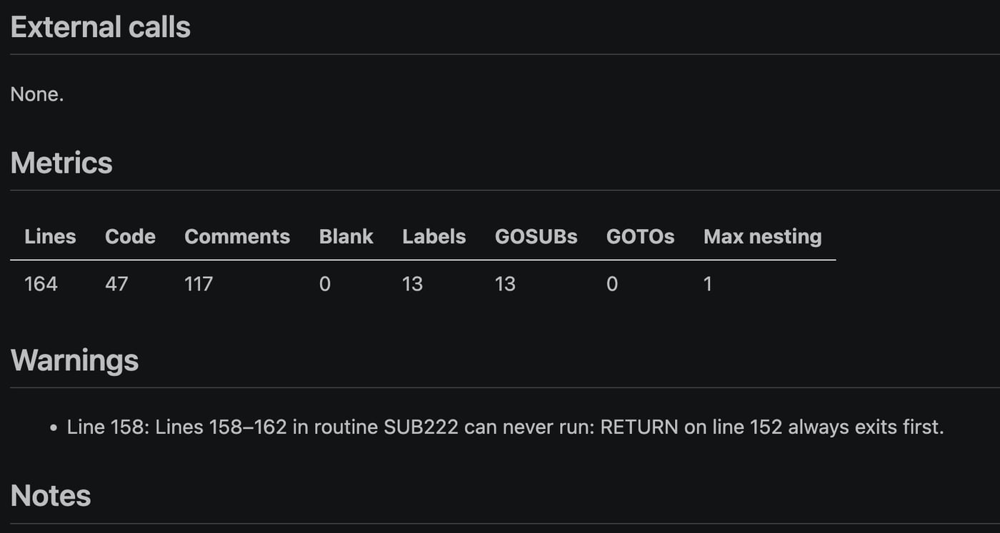

# MultiValue Basic Analyser

MultiValue Basic Analyser generates a structured documentation report for a Rocket UniVerse BASIC program. With a single command, it analyses the program open in the editor, writes the results to a Markdown file and opens the report in your web browser.

## Features

Each report contains:

- **Summary**: taken from the program's header comment.
- **Signature**: the program type and its parameters, with the likely direction of each parameter.
- **Metrics**: line, comment, label, GOSUB and GOTO counts, and the maximum block nesting depth.
- **Internal call tree**: every internal subroutine from the main body down (for example SUB1 → SUB11 → SUB111), in the order the calls are made. It is shown as a text tree and as a Mermaid or Markmap diagram.
- **External calls**: `CALL`, `DEFFUN`, `EXECUTE` and `PERFORM` statements, with links to the reports of called programs that have already been analysed.
- **Warnings**: unreachable code, missing and duplicate labels, uncalled routines, routines that run on into the next label, dynamic calls, and `READU` statements without a `LOCKED` clause.
- **Files**: each file opened, read, written, selected or deleted, with its file variable and line numbers.
- **Includes, common blocks and equates**.
- **Internal routines**: a table of every routine with its location, its callers and the routines it calls.
- **Notes**: a section for your own comments, which is preserved each time the report is regenerated.

The extension never modifies your source code, and all analysis takes place on your computer.

## Requirements

- Visual Studio Code 1.90 or later.
- To view reports in a browser: Google Chrome or Microsoft Edge with a Markdown viewer extension (see below). Alternatively, reports can be viewed in VS Code's built-in Markdown preview.

## Usage

Open a UniVerse BASIC program in VS Code. Files without an extension, such as those in `BP` folders, are supported. Then run **Analyse Program** in any of these ways:

- Right-click in the editor and select **Analyse Program**.
- Right-click the file in the Explorer and select **Analyse Program**.
- Press **Ctrl+Alt+A** (macOS: **Cmd+Alt+A**).
- Open the Command Palette and run **MultiValue Basic Analyser: Analyse Program**.

The extension analyses the program as it currently appears in the editor, including unsaved changes. A workspace is not required, and no other source files are read. Calls to programs that have already been analysed are linked to their existing reports.

The report is saved as `<PROGRAM>.md` and opened according to the **Open In** setting. Run the command again after changing the program to regenerate the report; anything you have written in the **Notes** section is kept.

## Screenshots

**Internal Call tree  overview.** 


**Report overview.** The summary is taken from the program's header comment, followed by the signature, files and other details.



**Metrics and warnings.** Each report highlights potential problems, such as code that can never run.




## Browser setup

Browsers display `.md` files as plain text unless a Markdown viewer extension is installed. Complete these steps once in Google Chrome; the steps for Microsoft Edge are similar.

1. Install a Markdown viewer extension from the Chrome Web Store, such as **Markdown Viewer**.
2. Go to `chrome://extensions`, select **Details** for the Markdown viewer extension, and turn on **Allow access to file URLs**. Without this permission the extension cannot open reports stored on your computer.
3. In the extension's options, enable **Mermaid** so that the call tree is drawn as a diagram. We also recommend enabling auto-reload, so that an open report refreshes when you analyse the program again.
4. Run **Analyse Program** on any program. The report should appear with formatted tables and diagrams.

**Viewing reports in VS Code instead.** Set **Open In** to `vscodePreview`, or select **Use VS Code Preview Instead** when the first-run message appears. The built-in preview displays tables but not Mermaid diagrams; to display diagrams as well, install the **Markdown Preview Mermaid Support** extension. Every report also includes a plain-text call tree, so it remains readable in any viewer.

**Markmap diagrams.** Markmap is supported by fewer Markdown viewers than Mermaid. Confirm that your viewer supports it before setting **Diagram** to `markmap`.

## Extension settings

To change these settings, open **Settings** and search for "MultiValue Basic Analyser".

| Setting | Default | Description |
| --- | --- | --- |
| Output Folder | *(empty)* | Folder where reports are saved. When empty, reports are saved in `docs/uvdoc` within the workspace, or in a `uvdoc` folder next to the program if no workspace is open. Relative paths are resolved from the workspace folder. Supports `${workspaceFolder}`, `${fileDirname}` and `~`. |
| Open In | `browser` | Where the report opens after it is generated: `browser`, `vscodePreview`, `both`, or `none` (save the file only). |
| Browser | `chrome` | Browser used to open reports: `chrome`, `edge`, `system` (the application your operating system associates with `.md` files, which may be a text editor), or `custom`. |
| Browser Path | *(empty)* | Full path to the browser executable. Used only when **Browser** is set to `custom`. |
| Diagram | `mermaid` | Diagram format for the call tree: `mermaid`, `markmap`, `both`, or `none`. The text call tree is always included. |
| Exclude Routines | *(empty)* | Routine labels to omit from the call tree and the Internal routines table, for example `OPENFILES` or `ERR.HANDLE`. Matching is not case-sensitive, and `*` and `?` can be used as wildcards (for example `ERR.*`). Routines called only through an excluded routine are also omitted, and the report lists what was excluded. |
| Max Tree Depth | `10` | Maximum depth of the call tree. Deeper calls are indicated with "…". |

If the selected browser cannot be found or started, the report opens in VS Code's Markdown preview and a message explains the reason.

## Reading the call tree

```text
TEST1 (main program)
├── SUB1          line 6   · called line 2
│   ├── SUB11     line 12  · called line 7
│   │   └── SUB111  line 20  · called line 15
│   └── SUB12     line 28  · called line 8
├── SUB2          line 57  · called line 3
...
```

- Routines are listed in the order in which they are called, not the order in which they appear in the source.
- `line` is the line where the label is defined; `called line` is the line of the GOSUB statement that calls it.
- **⚠ unreachable**: the GOSUB follows an unconditional RETURN, STOP or GOTO and can never run.
- **↺ recursive**: the routine calls a routine that is already active in the same call chain, so it is not expanded again.
- **(see above)**: the routine has already been expanded earlier in the tree.
- **(ON … GOSUB)**: the routine is one of the targets of an `ON x GOSUB a, b, c` statement.
- **⚠ label not found**: the GOSUB target is not defined in the program.

## Known limitations

- The analysis is static: the extension reads the source code but does not run the program or connect to a UniVerse server.
- A routine extends from its label to the next label. Code that it falls through to, or reaches with GOTO, is treated as part of the routine.
- Code is reported as unreachable when it follows an unconditional RETURN, STOP, ABORT, CHAIN or GOTO outside any IF, CASE or LOOP block. Unusual block structures can affect this result; the report includes a warning when block nesting does not balance.
- Parameter directions (in, out, in/out) are estimated from whether the routine assigns a value to each parameter.
- Dynamic calls (`CALL @variable`) and commands built at run time for `EXECUTE` are listed but cannot be resolved.
- The extension is designed for Rocket UniVerse BASIC. Other MultiValue dialects, including UniData BASIC, have not been tested.

## Installation from a VSIX file

In VS Code, open the **Extensions** view, select the **…** menu, choose **Install from VSIX…**, and select `multivalue-basic-analyser-1.0.0.vsix`.

Alternatively, run this command in a terminal:

```
code --install-extension multivalue-basic-analyser-1.0.0.vsix
```

## Support the project

MultiValue Basic Analyser is free, and it will stay that way. It grew out of many hours spent tracing GOSUB chains through long UniVerse programs, in the hope of giving every MultiValue developer a clearer view of the code they look after.

If it has saved you time, helped you understand an unfamiliar program, or made a code review a little easier, please consider buying me a coffee. Every contribution, large or small, is genuinely appreciated. It funds new features, support for more programs, and the late nights that go into them.

**[☕ Buy me a coffee](https://buy.stripe.com/5kQ9AUgkD5iT3Bwffq6EU02)**

You can also help by rating the extension on the Marketplace, sharing it with colleagues, or reporting anything that could work better. Thank you for your support.

---

Rocket and UniVerse are trademarks of Rocket Software, Inc. This extension is an independent project and is not affiliated with or endorsed by Rocket Software.
